# Windows Dynamic Island

**A floating, always-on-top control centre for Windows 10 and 11, inspired by the iPhone Dynamic Island.**

It sits at the top of your screen as a small pill. Click it (or press **Ctrl+Alt+Space**) and it expands into a panel of swipeable slides: planner, assistant, music, browser, search, network, a set of everyday tools and more.

  

<p align="center">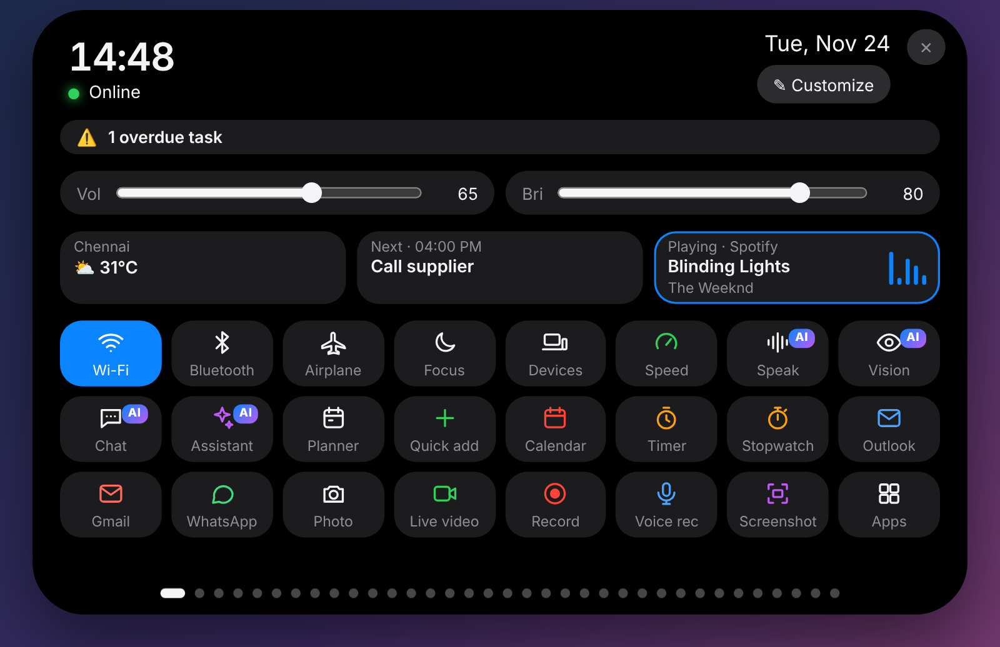</p>

Most of it runs on your PC with no network. Anything that talks to an AI model uses the one you choose in Settings: a local [Ollama](https://ollama.com) model by default, or Claude / ChatGPT with your own key.

---

## Contents

- [Download and install](#download-and-install)
- [Quick start](#quick-start)
- [Features](#features)
- [Keyboard shortcuts](#keyboard-shortcuts)
- [Settings](#settings)
- [Status colours](#status-colours)
- [Screenshots](#screenshots)
- [Run from source](#run-from-source)
- [Build the installer yourself](#build-the-installer-yourself)
- [Tests](#tests)
- [Privacy and security](#privacy-and-security)
- [Troubleshooting](#troubleshooting)
- [Project layout](#project-layout)
- [Contributing and licence](#contributing-and-licence)

---

## Download and install

Get the latest build from the **[Releases page](../../releases/latest)**.

| File | What it is |
| --- | --- |
| `Dynamic.Island-<version>-installer.exe` | Installer: choose a folder, shortcuts, uninstaller. Installing over an older version updates it and closes the running island first. |
| `Dynamic.Island-<version>-portable.exe` | One file, no install. Your data is kept in a `DynamicIslandData` folder next to it, so you can carry it on a USB drive. |

GitHub shows the spaces in the file names as dots.

**SmartScreen warning.** The builds are not code-signed, so Windows may show "Windows protected your PC" the first time. Choose **More info → Run anyway**.

**Updating.** Download the new installer and run it over the old one (or run the new portable exe). If anything still shows the old version, right-click the tray icon, choose **Quit**, and start the new one. *Settings → About* shows which version is running.

---

## Quick start

1. Run the installer (or the portable exe). A small pill appears at the top of the screen and an icon appears in the notification area next to the clock.
2. Click the pill, or press **Ctrl+Alt+Space**, to open the island.
3. Swipe, use the arrow keys, or click the dots under the panel to move between slides. Hover the dots to see slide names.
4. Press **Ctrl+Alt+N** and type `Call supplier at 4 PM` to add your first task.
5. Open **Settings** from the tray icon (right-click → Settings) to choose your AI model, slides and shortcuts.

On Windows 11 a new tray icon may start in the **^** overflow. Drag it onto the taskbar, or turn it on in *Settings → Personalization → Taskbar → Other system tray icons*.

---

## Features

Every slide can be hidden or reordered in **Settings → Menus** (drag a row by its handle, or use the ▲ ▼ arrows). Home is always first.

### Home
- Quick tiles: Wi-Fi, Bluetooth, Airplane, Focus
- **Speak**, **Vision** and **Chat with AI** buttons
- A camera strip: Photo, Live video, Record, Voice rec, Screenshot
- Message shortcuts (Outlook, Gmail, WhatsApp) and your own buttons
- Volume and brightness sliders, weather, tasks and music chips
- **Customize** (top right) adds, removes and reorders buttons and hides rows

### Daily productivity
| Slide | What it does |
| --- | --- |
| **Planner** | Today's plan: overdue, today, upcoming, anytime, done. Category filters, a progress bar and an Eisenhower matrix view. |
| **Habits** | Tick a habit each day; streaks and last-7-days dots. |
| **Daily goals** | Targets that reset each day (for example 8 glasses of water). |
| **Journal** | Daily notes with a mood, a "+ Done today" button and ideas from Quick Capture. |
| **Expenses** | Amount and note, category guessed from the note, totals for today, 7 days and the month. |
| **Tasks & reminders** | Tasks with an optional time. When due, the island expands with a chime and offers Done / Snooze 5 min / Dismiss. |
| **Calendar** | Month grid, events and reminders for each day. |
| **Timer & stopwatch** | Timer with presets and a progress ring; stopwatch with laps and best/worst highlighted. |
| **Shopping list** | A checklist: type, or say "add milk to the shopping list". |
| **Alarms and clocks** | Alarm clock, world clock, Pomodoro focus timer and countdowns. |

**Quick Capture** (Ctrl+Alt+N) understands plain sentences, locally with no network:

- `Buy groceries tomorrow` → task, tomorrow, Shopping
- `Call supplier at 4 PM` → task, today 4 PM, Work
- `Complete Excel report before 6 PM` → deadline 6 PM, reminder 5:30 PM
- `every Monday at 10am`, `daily`, `every weekday`, `monthly`, `25 Dec`, `in 30 minutes`, `tonight`, `urgent: ...`
- `... when I plug in`, `... when I'm online`, `... when I unlock`
- `idea: ...` saves to the Journal; `spent 250 on lunch` saves an expense

### Smart assistant
Open the Assistant slide, press **Ctrl+Alt+V**, or use the Speak button, then type or say things in your own words.

- **Daily briefing** built on your PC from tasks, events, habits, goals, spending and unread mail
- **Voice productivity:** "What's pending today?", "Set a timer for 25 minutes", "Open Chrome", "Turn volume up", "Mark buy milk as done", "Turn off Bluetooth", "Lock the computer"
- **Screen assistant:** "Explain this screen" gives short next steps you can tap
- **Smart scheduling:** "Find time for my unfinished tasks", "When am I free tomorrow?"
- **Summaries and writing help:** summarise selected text, mail, clipboard or a document; fix grammar, make it formal, translate, draft an email
- **Meeting notes:** records in short pieces, writes a summary, decisions and action items. Audio is never saved.
- **Natural-language search** across tasks, events, notes, journal, expenses, chats and files
- **Contextual suggestions** and **personal memory** (saved only after you say yes)

### Browse and find
- **Music:** now playing, previous / play-pause / next, volume. A live pill shows the track while the island is collapsed.
- **Browser:** type a URL or search, with your own quick links.
- **Sticky pad:** three notes, saved automatically.
- **Find:** installed apps as an icon grid, open windows, files (Windows Search), recent files.
- **Photos, Weather, News:** your Pictures folder, Open-Meteo weather, and an RSS feed you choose.

### System and network
- **Wi-Fi & Bluetooth:** switch radios, see nearby networks, connect, forget. Bluetooth shows paired devices.
- **Network speed:** live download/upload graph and a speed test (ping, jitter, download, upload) with history.
- **Health & usage:** screen time, idle time, time per app, battery level and drain.
- **System:** CPU, memory, storage, uptime.
- **Style:** theme, island size and colour, accent, status glow, live pill.

### Tools
Clipboard history, text expander, window layouts, quick launch, file renamer (with undo), phone-to-PC file transfer over Wi-Fi, screenshot OCR (offline), calculator and converter, QR codes.

### Task manager
Running apps with icon, window title and memory. Tick any number and press **End selected** (asks first). Apps are closed politely before anything is forced. Windows' own programs are locked and cannot be ended.

### Messages
Unread mail and messages arrive on the island:
- **Outlook:** the classic desktop app (must be open)
- **Gmail:** IMAP with a Google app password
- **WhatsApp:** WhatsApp Web in a background window (scan the QR once)

**Focus** mode holds back pop-ups and sounds; reminders still ring.

### Capture
Photos, live video, screen recordings, voice notes and screenshots, saved to Pictures, Videos and Music under **Dynamic Island** (change in *Settings → General → Capture folder*). Screenshots can hide the island or keep the collapsed pill, with an optional 3 / 5 / 10 second delay.

---

## Keyboard shortcuts

| Shortcut | Action | Where to change it |
| --- | --- | --- |
| **Ctrl+Alt+Space** | Open or close the island | Settings → General |
| **Ctrl+Alt+N** | Quick Capture a task | Settings → General |
| **Ctrl+Alt+V** | Talk to the Assistant | Settings → Assistant |
| **Ctrl+Alt+O** | Screenshot OCR | Settings → Tools |
| **← / →** | Previous / next slide | Fixed |
| **Esc** | Close menus | Fixed |

---

## Settings

Open from the tray icon (right-click → Settings) or the Style slide.

| Tab | Contents |
| --- | --- |
| **General** | Theme, accent, clock, date format, shortcuts, start with Windows, hide in full screen, location, units, news, folders, screenshot options |
| **Menus** | Show, hide and reorder every slide |
| **Tools** | Clipboard, text expander, OCR and quick-launch options |
| **AI & chat** | Local model (Ollama), Claude and ChatGPT keys, voice and vision models, planner AI |
| **Assistant** | Daily briefing, suggestions, voice shortcut, working hours, lunch, memory, meeting notes |
| **Wellness & alerts** | Break reminders and health alerts |
| **Security** | Optional passphrase for the encrypted vault, auto-lock, erase |
| **Messages** | Outlook, Gmail and WhatsApp setup |
| **Chat history** | Read, continue and delete past chats |
| **About** | Version, features, status colours and shortcuts |

---

## Status colours

The collapsed pill glows to show state (first match wins):

| Colour | Meaning |
| --- | --- |
| Blue | Listening |
| Amber | Thinking |
| Purple | Speaking |
| Red | Offline |
| Yellow | Low battery |
| Grey | Airplane mode |
| Indigo | Focus on |
| Green | Online |

---

## Screenshots

Rendered from the real interface with sample data.

### Home
The first screen you see. Quick tiles, volume and brightness, weather, next task, now-playing and your own buttons.


### Assistant and AI chat

| Assistant | Ask in your own words | AI chat |
| --- | --- | --- |
| 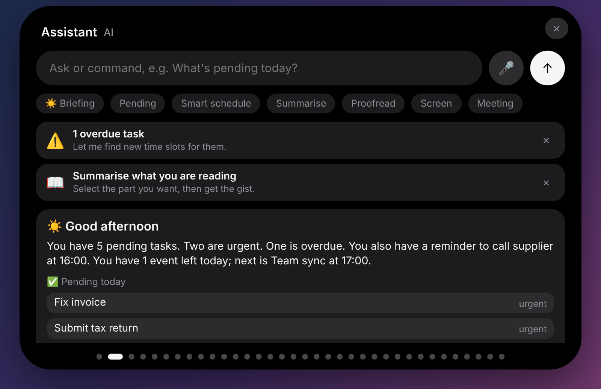 | 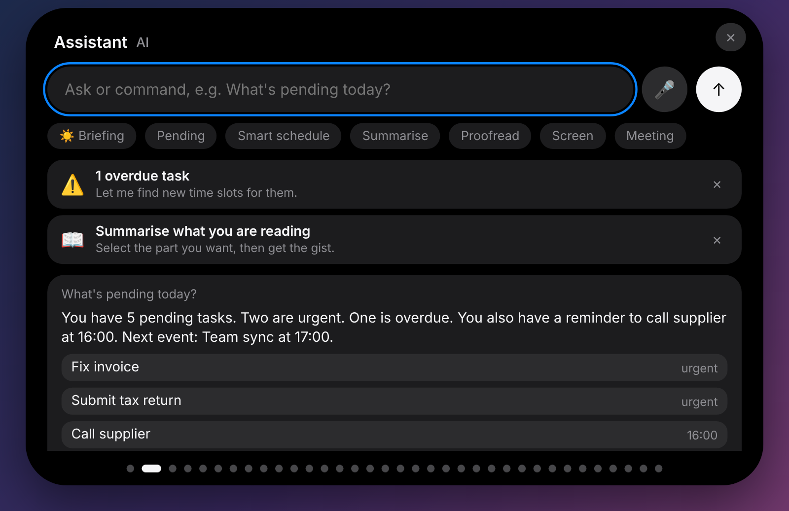 | 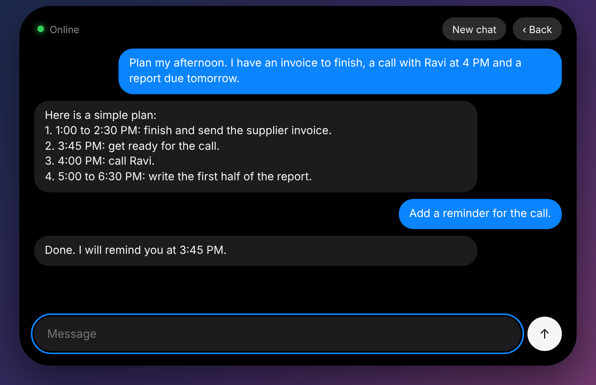 |

### Music, Messages and File transfer

| Music | Messages |
| --- | --- |
| 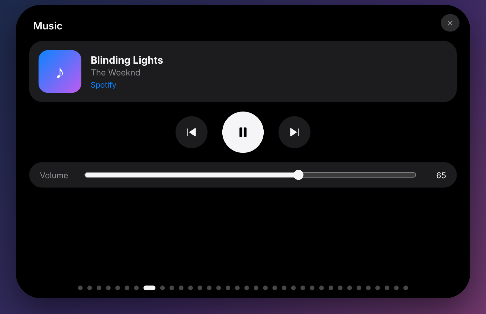 | 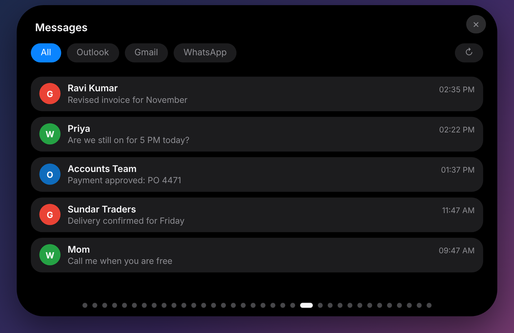 |

| File transfer | Sharing with a QR code |
| --- | --- |
| 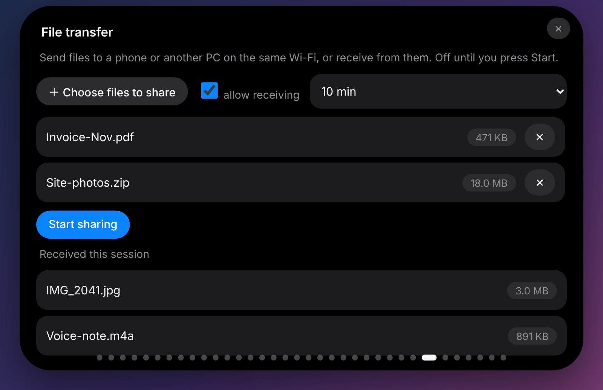 | 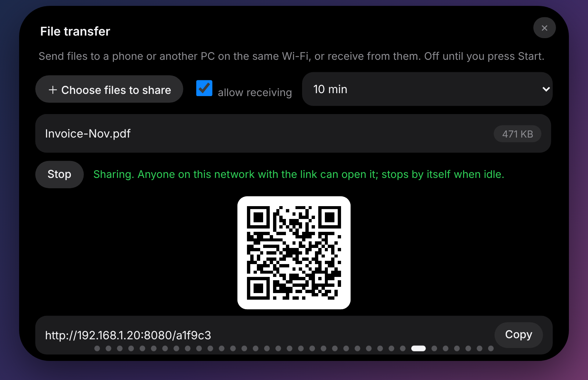 |

### The pill (collapsed island)
The island stays a small pill until you need it. It widens into a live pill for music and timers, and expands for new messages and reminders.

| Idle | Music playing | Timer running |
| --- | --- | --- |
| 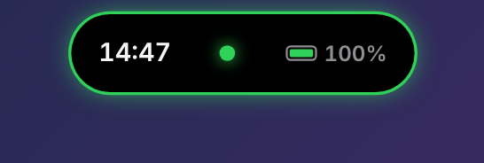 | 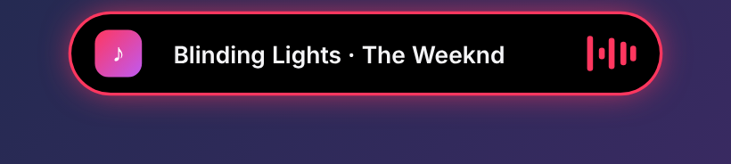 | 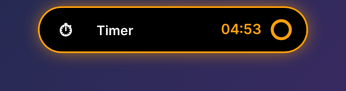 |

| New message | Reminder |
| --- | --- |
| 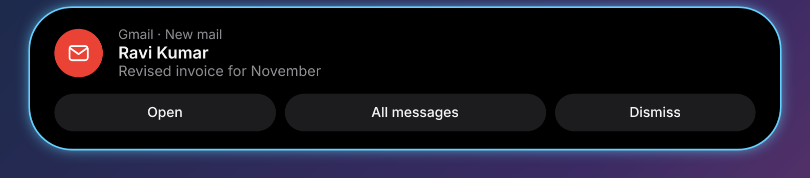 | 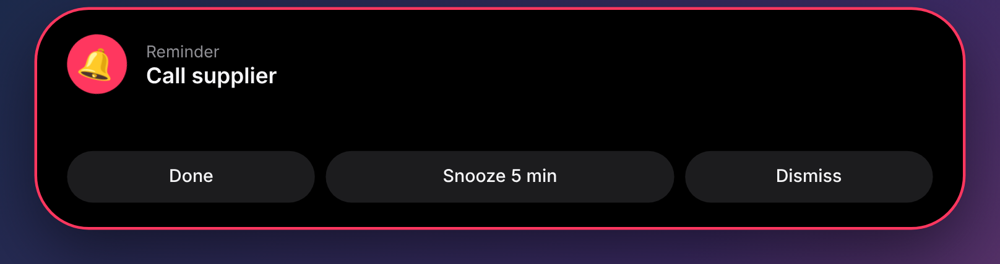 |

### More tools

| Task manager | Find | Quick launch |
| --- | --- | --- |
|  | 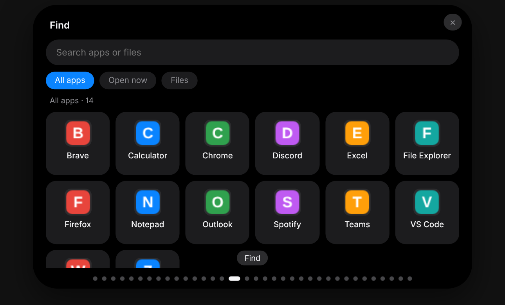 | 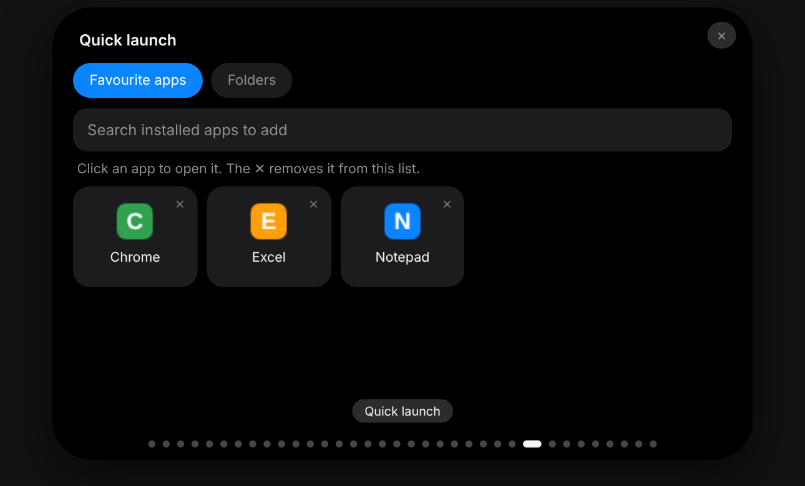 |

| Text expander | File renamer | Calculator |
| --- | --- | --- |
| 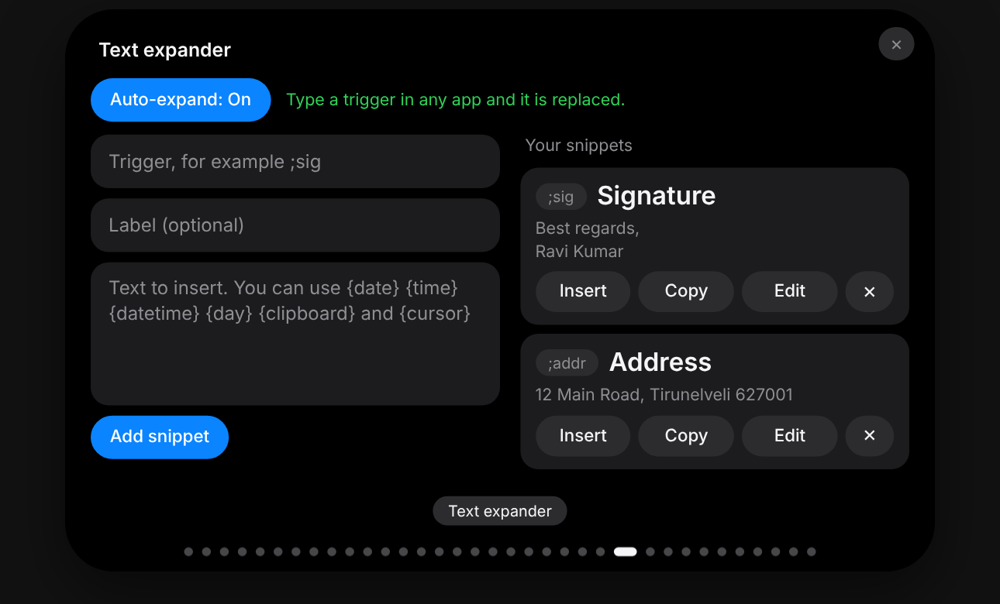 |  | 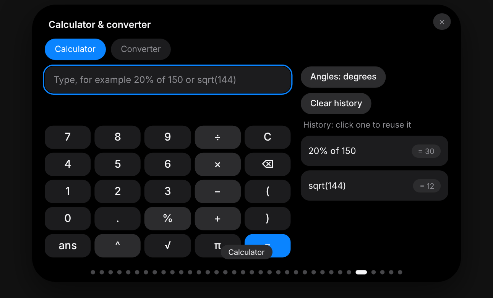 |

---

## Run from source

Needs Windows 10/11 and Node.js 18 or newer.

```bash
cd dynamic-island
npm install
npm start
```

Optional extras:
- [Ollama](https://ollama.com) for local chat: `ollama pull llama3.2:1b`
- A vision model for screen questions: `ollama pull gemma3:4b`
- whisper.cpp for voice (see `dynamic-island/whisper/README.txt`)

## Build the installer yourself

On Windows, double-click `dynamic-island/build-windows.bat`, or:

```bash
cd dynamic-island
npm install
npm run dist
```

The installer and portable exe appear in `dynamic-island/dist/`. Use `npm run dist:installer` or `npm run dist:portable` to build only one. To publish a release see [docs/RELEASING.md](docs/RELEASING.md).

## Tests

The tests are plain Node and need no install and no Windows:

```bash
cd dynamic-island
npm test
```

`npm run test:ui` runs headless-browser checks of the real interface and needs [Playwright](https://playwright.dev). GitHub runs the tests on every push and pull request.

---

## Privacy and security

- Tasks, calendar, scheduling, search, briefings and voice commands stay on your PC.
- Only text you point at (a selection, the clipboard, a file, a transcript or a screenshot) is sent to the AI model you pick. Each answer says which engine produced it: "via Claude", "via local model", "on this PC" or "offline".
- Tasks, calendar and memory are added to a prompt only with the local model, or when you switch on sharing for Claude / ChatGPT (off by default).
- API keys and the Gmail app password are stored in an AES-256-GCM encrypted vault. An optional passphrase (scrypt) means nothing on disk can open it without that passphrase.
- Hardening: sandboxed windows, IPC only from the app's own pages, no pop-ups or navigation away, camera and microphone only while a capture screen is open, "open file" refuses programs and scripts, single instance.
- Meeting audio is never saved.
- The internet check contacts only Windows' own connectivity address (msftconnecttest.com).

More detail: [docs/GUIDE.md](docs/GUIDE.md).

---

## Troubleshooting

| Problem | What to try |
| --- | --- |
| Settings or slides look like an old version | Right-click the tray icon → **Quit**, then start the new build. Check *Settings → About*. |
| The island does not appear | Press **Ctrl+Alt+Space**. Check the tray icon (it may be in the ^ overflow). Turn off *Hide in full screen* if a full-screen app is open. |
| Wi-Fi list is empty (Windows 11) | Turn on **Location** in Windows Settings. The slide has a button for it. |
| Voice does nothing | Add whisper.cpp and a model to `dynamic-island/whisper/` (see its README). |
| Chat does not answer | Start Ollama and run `ollama pull llama3.2:1b`, or add a Claude / ChatGPT key in *Settings → AI & chat*. |
| Does not start with Windows | Check *Task Manager → Startup apps*; Windows keeps its own switch there. |
| A tool cannot end a program | Programs running as administrator cannot be ended from the island. |

---

## Project layout

```
dynamic-island/   the Electron app (main.js, index.html, settings.html, tools, PowerShell helpers)
tests/            unit, integration and UI tests
docs/             feature guide, release guide, screenshots
.github/          CI and release workflows
RELEASE.md        release notes for the current version
CHANGELOG.md      every version
```

## Contributing and licence

Issues and pull requests are welcome; please run `npm test` first.

No licence has been chosen yet, so by default all rights are reserved. Add a `LICENSE` file (for example MIT) before inviting others to reuse the code.
