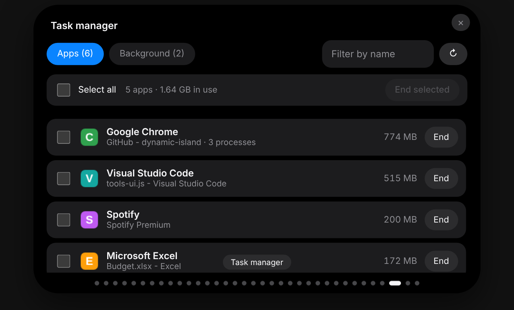
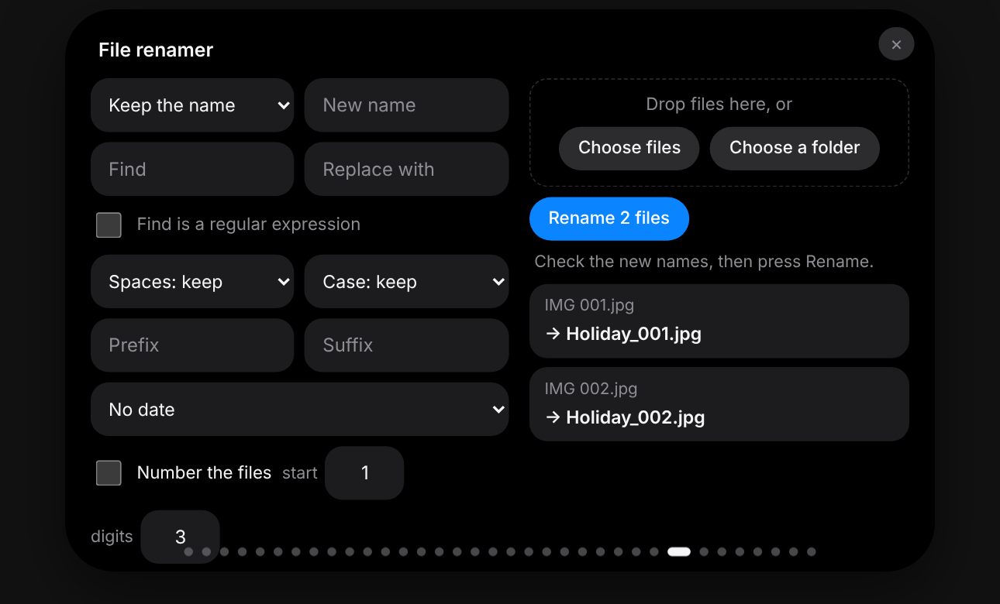

# Windows Dynamic Island

A floating, always-on-top control centre for Windows 10/11, inspired by the iPhone Dynamic Island. It sits at the top of your screen as a small pill and expands into a panel of swipeable slides: music, browser, find, planner, assistant, system, network, a set of everyday tools and more.

Most of it runs on your PC with no network. Anything that talks to an AI model uses the one you choose in Settings (a local Ollama model by default).

## Download

Get the latest build from the **[Releases page](../../releases/latest)**:

| File | What it is |
| --- | --- |
| `Dynamic.Island-<version>-installer.exe` | Installer: choose a folder, shortcuts, uninstaller. |
| `Dynamic.Island-<version>-portable.exe` | Single file, no install. Data is kept in a `DynamicIslandData` folder next to it. |

(GitHub shows the spaces in the file names as dots.) The builds are not code-signed, so Windows SmartScreen may warn on first run: choose **More info > Run anyway**.

Open or close the island with **Ctrl+Alt+Space** (changeable in Settings).

## What is inside

- **Home, Music, Browser, Sticky pad, Find, Health & usage, System, Style**
- **Find:** installed apps as an icon grid, open windows, files (Windows Search), recent files
- **Planner, Habits, Daily goals, Journal, Expenses**, with Quick Capture (`Buy groceries tomorrow`)
- **Smart assistant:** daily briefing, voice commands, screen questions, scheduling, summaries, writing help, meeting notes, memory
- **Wi-Fi & Bluetooth, Network speed** with a speed test
- **Tools:** clipboard history, text expander, window layouts, quick launch, file renamer, phone-to-PC file transfer, screenshot OCR, calculator and converter, QR codes
- **Task manager:** running apps with icons, tick any number and end them, with safeguards for Windows itself

Every slide can be hidden or reordered in **Settings > Menus**. The full feature guide is in [docs/GUIDE.md](docs/GUIDE.md).

## Screenshots

Rendered from the real interface with sample data.

| Task manager | Find | Quick launch |
| --- | --- | --- |
|  |  |  |

| Text expander | File renamer | Calculator |
| --- | --- | --- |
|  |  |  |

## Run from source

Needs Windows 10/11 and Node.js 18 or newer.

```bash
cd dynamic-island
npm install
npm start
```

Optional extras: [Ollama](https://ollama.com) for local chat (`ollama pull llama3.2:1b`), and whisper.cpp for voice (see `dynamic-island/whisper/README.txt`).

## Build the installer yourself

On Windows, double-click `dynamic-island/build-windows.bat`, or:

```bash
cd dynamic-island
npm install
npm run dist
```

The installer and portable exe appear in `dynamic-island/dist/`. To publish a release see [docs/RELEASING.md](docs/RELEASING.md).

## Tests

The tests are plain Node and need no install and no Windows:

```bash
cd dynamic-island
npm test
```

`npm run test:ui` runs headless-browser checks of the real interface and needs [Playwright](https://playwright.dev).

## Project layout

```
dynamic-island/   the Electron app (main.js, index.html, settings.html, tools, helper PowerShell scripts)
tests/            unit, integration and UI tests
docs/             feature guide, release guide, screenshots
.github/          CI and release workflows
```

## Privacy

Tasks, calendar, scheduling, search, briefings and voice commands stay on this PC. Only text you point at (a selection, the clipboard, a file, a transcript or a screenshot) is sent to the AI model you pick, and each answer says which engine produced it. Details: the Privacy section of [docs/GUIDE.md](docs/GUIDE.md).

## Contributing and licence

Issues and pull requests are welcome; please run `npm test` first. No licence has been chosen yet, so by default all rights are reserved. Add a `LICENSE` file before inviting others to reuse the code.
